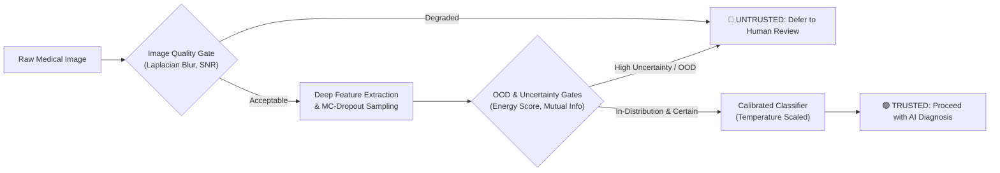

# AI That Knows When a Medical Image Cannot Be Trusted

### Selective Prediction, Epistemic Uncertainty Quantification & Out-of-Distribution Triage for Safe Clinical Imaging

[](https://www.python.org/)
[](https://pytorch.org/)
[-green.svg)](https://medmnist.com/)
[](LICENSE)

---

## 🔬 Core Scientific Hypothesis

Deep learning models deployed in medical image interpretation often achieve impressive headline accuracy, yet suffer from **catastrophic overconfidence** when encountering:
1. **Severe Acquisition Artifacts & Physical Degradations:** Stage vibration blur, optical defocus, detector photon noise, and histological H&E chemical stain fading.
2. **Out-of-Distribution (OOD) Domain Shifts:** Foreign imaging modalities, mismatched patient cohorts, or non-medical images masquerading as clinical scans.
3. **Hazardous Silent Failures:** Incorrect diagnostic predictions asserted with deceptively high softmax confidence ($> 90\%$) and low entropy.

> **Our Trustworthy Solution:**
> We engineer a multi-signal reliability and selective prediction architecture. Instead of blindly forcing a prediction, the AI interrogates its own internal representations, estimates **epistemic uncertainty via Monte Carlo Dropout**, evaluates **deep feature and energy-based OOD scores**, screens **physical image quality**, and **selectively abstains** by deferring suspicious cases to a senior human pathologist.



---

## 📂 Project Architecture

```
2_AI That Knows When a Medical Image Cannot Be Trusted/
├── configs/
│   ├── dataset.yaml                  # PathMNIST and OOD dataset configurations
│   ├── training.yaml                 # Optimizer, LR scheduler, MC-Dropout hyperparameters
│   └── experiments.yaml              # Corruption suite and selective triage parameters
├── data/
│   ├── raw/                          # Downloaded MedMNIST .npz partitions
│   ├── processed/                    # Processed datasets and metadata JSON
│   └── README.md                     # Dataset provenance, licence (CC BY 4.0), and splits
├── src/
│   ├── data/
│   │   └── dataset.py                # Split hygiene loaders (PathMNIST, DermaMNIST, BloodMNIST)
│   ├── models/
│   │   └── classifier.py             # TrustworthyMedicalCNN with MC-Dropout & feature hooks
│   ├── corruptions/
│   │   └── image_corruptions.py      # Controlled physical corruptions & Image Quality Assessor (IQA)
│   ├── uncertainty/
│   │   └── estimator.py              # Epistemic vs Aleatoric uncertainty decomposition
│   ├── calibration/
│   │   └── temperature_scaling.py    # Post-hoc Temperature Scaling, ECE, MCE & Brier score
│   ├── ood/
│   │   └── detector.py               # MSP, Energy-based, and Mahalanobis distance OOD detectors
│   ├── abstention/
│   │   └── policy.py                 # Multi-signal clinical triage & risk-coverage curve (AURC)
│   └── evaluation/
│       ├── metrics.py                # Classification, silent failure analysis, AUROC of errors
│       └── visualizer.py             # Publication-quality calibration and robustness figures
├── scripts/
│   ├── prepare_data.py               # Step 1: Ingest, verify class balance and dataset hashes
│   ├── train.py                      # Step 2: Train baseline CNN with MC-Dropout and checkpointing
│   ├── evaluate.py                   # Step 3: Validation-guided calibration & locked test evaluation
│   ├── run_robustness.py             # Step 4: Multi-severity corruption audit & OOD benchmarks
│   └── run_pipeline.py               # Unified end-to-end master lifecycle orchestrator
├── tests/
│   └── test_pipeline_modules.py      # Comprehensive pytest test suite for all modules
├── experiments/
│   ├── checkpoints/                  # Saved weights (best_model.pt) and training logs
│   └── results/                      # Serialized test metrics, calibration, and policy states
├── reports/
│   ├── figures/                      # High-resolution PNG publication figures
│   └── RESEARCH_REPORT.md            # Comprehensive scientific findings and clinical disclosures
├── app.py                            # Interactive Streamlit clinical triage inspection dashboard
├── setup_environment.sh              # Automated virtualenv setup and dependency installation
└── requirements.txt                  # Python dependencies
```

---

## 🚀 Quickstart Guide

### 1. Environment Setup
Run the automated environment setup script:
```bash
./setup_environment.sh
```
Or manually activate your virtual environment:
```bash
source .venv/bin/activate
pip install -r requirements.txt
```

### 2. Run the Full End-to-End Pipeline
Execute the complete scientific lifecycle (data verification, training, calibration, locked test evaluation, and robustness audit) with one command:
```bash
python scripts/run_pipeline.py --device auto --epochs 10 --seed 42
```

### 3. Launch the Interactive Clinical Triage Dashboard
Inspect query images, apply live corruptions (blur, noise, stain fading), and observe real-time abstention decisions:
```bash
streamlit run app.py
```

### 4. Run Unit Tests
```bash
pytest tests/ -v
```

---

## 📊 Scientific Framework & Mathematical Methodology

### 1. Epistemic Uncertainty Decomposition (Monte Carlo Dropout)
For an input $x$ and $T$ stochastic dropout passes $\{W^{(1)}, \dots, W^{(T)}\}$:
$$\bar{p}_c = \frac{1}{T} \sum_{t=1}^T p_c^{(t)}$$
- **Total Uncertainty (Predictive Entropy):**
  $$H(\bar{p}) = -\sum_{c=1}^C \bar{p}_c \log \bar{p}_c$$
- **Aleatoric Uncertainty (Data Noise):**
  $$\mathbb{E}_t[H(p^{(t)})] = \frac{1}{T} \sum_{t=1}^T \left(-\sum_{c=1}^C p_c^{(t)} \log p_c^{(t)}\right)$$
- **Epistemic Uncertainty (Model Ignorance / Mutual Information):**
  $$I(y, W \mid x) = H(\bar{p}) - \mathbb{E}_t[H(p^{(t)})]$$

### 2. Post-Hoc Probability Calibration (Temperature Scaling)
Raw logits $z(x)$ are scaled by temperature $T > 0$ fitted strictly on the validation partition via Negative Log-Likelihood minimization:
$$p_i^{\text{calibrated}} = \frac{\exp(z_i / T)}{\sum_j \exp(z_j / T)}$$
Expected Calibration Error (ECE) is quantified across $M$ confidence bins:
$$\text{ECE} = \sum_{m=1}^M \frac{|B_m|}{N} \left|\text{acc}(B_m) - \text{conf}(B_m)\right|$$

### 3. Out-of-Distribution (OOD) Detection
- **Energy-Based OOD Score:**
  $$S_{\text{energy}}(x) = T_{\text{energy}} \cdot \log \sum_{c=1}^C \exp\left(\frac{z_c(x)}{T_{\text{energy}}}\right)$$
- **Deep Feature Mahalanobis Distance:**
  $$M(x) = \min_{c} \left(f(x) - \hat{\mu}_c\right)^T \hat{\Sigma}^{-1} \left(f(x) - \hat{\mu}_c\right)$$

### 4. Selective Prediction & Clinical Abstention
A selective classifier $(f, g)$ accepts $(g(x)=1)$ or defers $(g(x)=0)$:
- **Coverage:** $\phi(g) = \mathbb{E}[g(x)]$
- **Selective Risk:** $R(f, g) = \frac{\mathbb{E}[\ell(f(x), y) g(x)]}{\phi(g)}$
- **Area Under Risk-Coverage Curve (AURC):** Measures the efficiency of the abstention policy across all coverage levels.

---

## ⚠️ Clinical Disclaimer & Research Limitations

This software repository is a **research prototype** developed to investigate failure detection and selective prediction in artificial neural networks.
- It is **NOT** a certified medical diagnostic device.
- It must **NEVER** be used for primary patient diagnosis or clinical treatment planning without human supervision.
- Even calibrated uncertainty and OOD detectors can experience **silent failures** (confidently incorrect predictions), reinforcing the necessity of human-in-the-loop clinical oversight.
